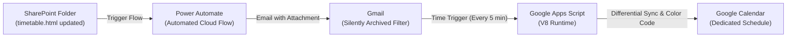
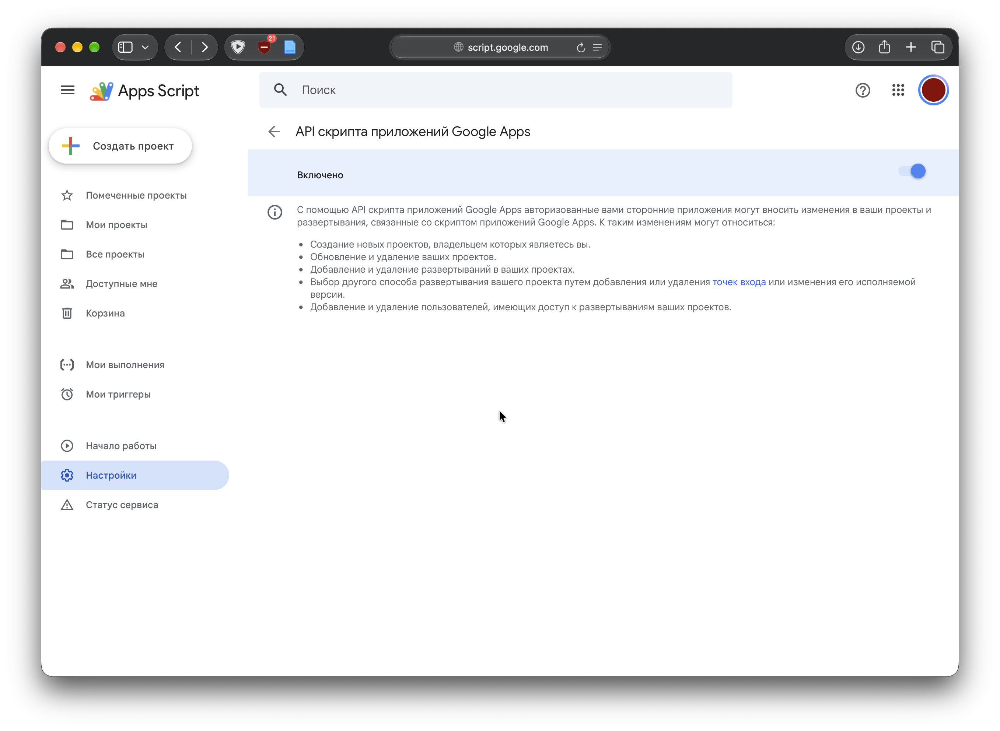
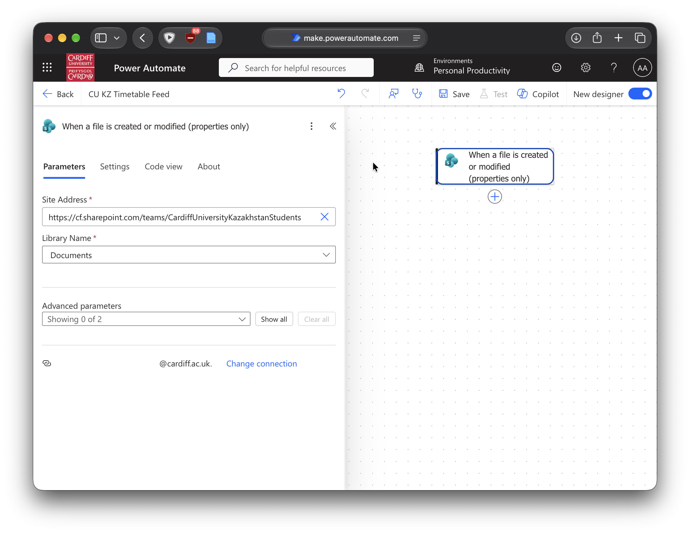
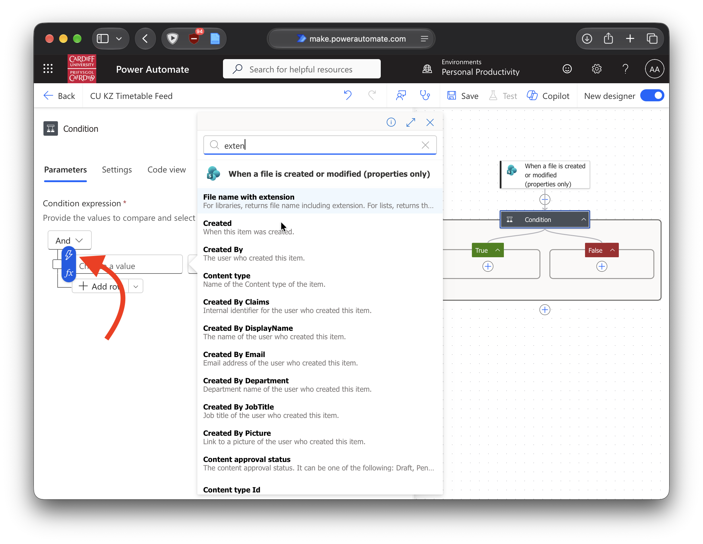
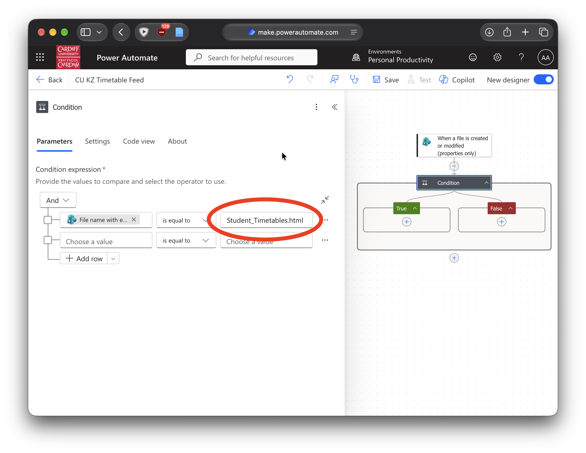
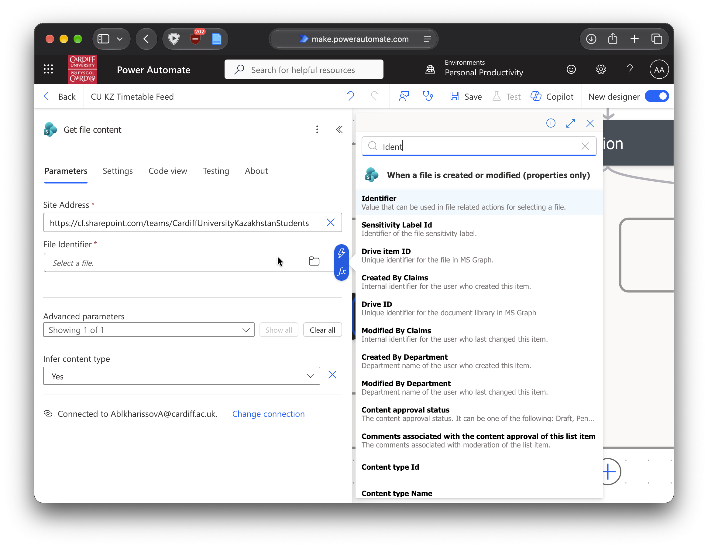
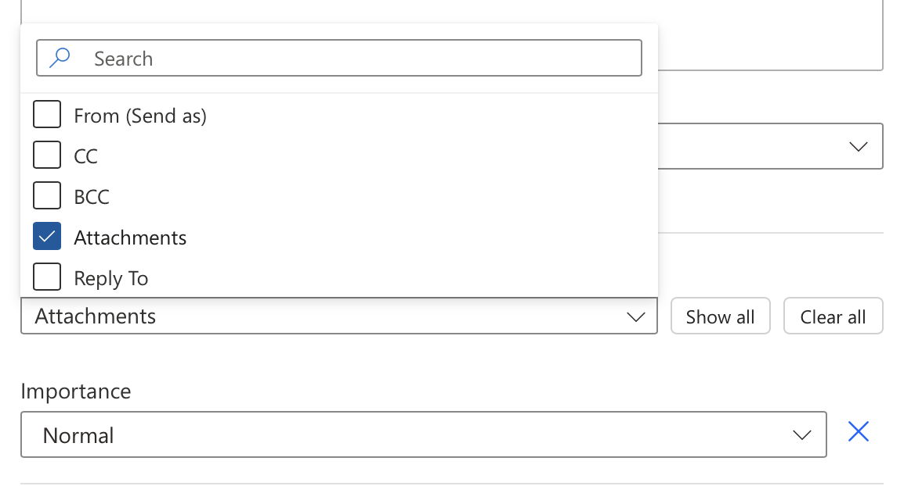
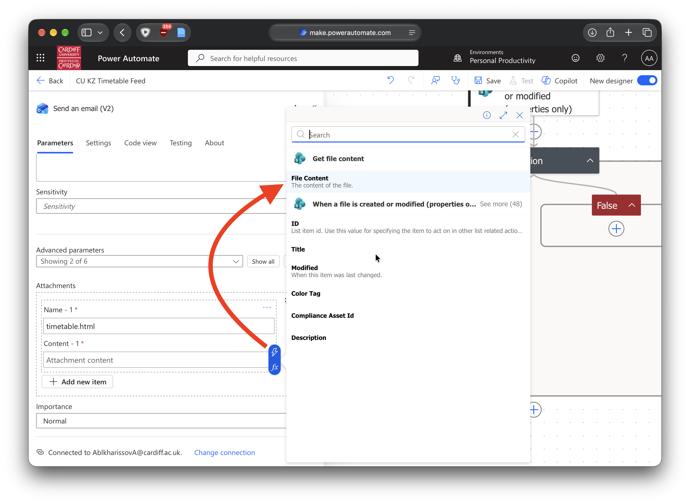

# Cardiff University Kazakhstan Timetable Sync

[](https://www.typescriptlang.org/)
[](https://bun.sh/)
[](https://developers.google.com/apps-script)
[](https://esbuild.github.io/)

A serverless, automated synchronization service built for Cardiff University Kazakhstan students. It extracts timetable schedules from emailed HTML attachments, matches courses to your Student ID, and synchronizes them directly into a dedicated Google Calendar.

---

## Architecture & Data Flow



1. **Source Publishing**: The university updates `timetable.html` in the student SharePoint folder.
2. **Automated Forwarding**: Microsoft Power Automate triggers on file update and emails `timetable.html` to Gmail with subject `[TIMETABLE]`.
3. **Silent Ingestion**: A Gmail filter silences notifications and archives the message while preserving `is:unread` status.
4. **Script Execution**: A Google Apps Script time-driven trigger runs every 5 minutes, parses the embedded JSON payload, filters classes by student ID, and performs a differential calendar sync.
5. **Reconciliation & Idempotency**: Stale or cancelled events are pruned, unchanged events skip API calls, and the email is marked read upon complete sync.

---

## Key Technical Features

* **Differential Upserts & Quota Optimization**: Existing events are indexed in memory ($O(1)$ lookup). Property updates only execute if title, time, location, description, or color differ, saving Google Apps Script daily API quotas.
* **Orphan & Cancellation Reconciliation**: Cleans up dropped or rescheduled classes by deleting any previously tagged timetable events that no longer exist in the incoming schedule.
* **Deterministic Color Coding**: Hashes course module codes (e.g. `EL0016`) to 11 Google Calendar palette colors, ensuring every lecture or seminar for a module shares a consistent color.
* **Rate-Limit & Timeout Protection**:
  * Mutations (creates, updates, deletes) are throttled (`200ms` sleep every 5 operations) to avoid Calendar API burst rate limits.
  * 4-minute soft execution guard (`MAX_EXECUTION_TIME_MS`) prevents abrupt termination from GAS's 6-minute hard limit.
  * Auto-resuming: Partial syncs keep the email unread, allowing the subsequent trigger run to fast-forward in-memory and finish remaining events.

---

## Project Structure

```text
cukz-timetable-feed/
├── .clasp.json              # Clasp configuration (scriptId, rootDir: "dist") [GITIGNORED]
├── appsscript.json          # Google Apps Script manifest (V8 runtime, timezone)
├── build.ts                 # esbuild bundling script with esbuild-gas-plugin
├── package.json             # NPM package scripts and dependencies
├── tsconfig.json            # TypeScript configuration
├── AGENTS.md                # Agent & contributor guidelines
├── README.md                # Developer and user documentation
├── dist/                    # Bundled output pushed to Apps Script [GITIGNORED]
│   ├── appsscript.json      # Manifest copied during build
│   └── index.js             # Bundled GAS script
├── public/images/           # Setup screenshots for documentation
└── src/
    ├── config.ts            # Active user configuration [GITIGNORED]
    ├── config.example.ts    # Template configuration reference
    ├── index.ts             # Main entry point & calendar sync engine
    └── types.ts             # TypeScript interfaces and payload schemas
```

---

## Prerequisites

* [Bun](https://bun.sh/) (v1.0+) installed locally.
* Google Account with access to [Google Apps Script](https://script.google.com/) and [Google Calendar](https://calendar.google.com/).
* Cardiff University Microsoft 365 account with SharePoint and Power Automate access.

---

## Quickstart & Local Setup

### 1. Clone & Install Dependencies

```shell
git clone https://github.com/arsendgaf/cukz-timetable-feed.git
cd cukz-timetable-feed
bun install
```

### 2. Configure Environment

Copy the example configuration file to `src/config.ts`:

```shell
cp src/config.example.ts src/config.ts
```

Edit `src/config.ts` with your parameters:

```typescript
import { ScriptConfig } from './types';

export const CONFIG: ScriptConfig = {
  ALLOWED_SENDER: 'your-email@cardiff.ac.uk',
  ATTACHMENT_NAME: 'timetable.html',
  MY_STUDENT_ID: '12345678', // Your 8-digit Student ID
  CALENDAR_ID: 'your_calendar_id@group.calendar.google.com' // Dedicated Google Calendar ID
};
```

> [!CAUTION]
> `src/config.ts` contains personal student credentials and is excluded by `.gitignore`. Never commit credentials to version control.

### 3. Create a Dedicated Google Calendar

1. Open [Google Calendar](https://calendar.google.com/).
2. Next to **Other calendars**, click **+** > **Create new calendar**.
3. Name it (e.g. `University Timetable`) and click **Create calendar**.
4. Open the calendar settings, navigate to **Integrate calendar**, and copy the **Calendar ID**.
5. Paste this ID into `CONFIG.CALENDAR_ID` in `src/config.ts`.

---

## Google Apps Script Deployment

### 1. Enable Google Apps Script API

Visit [Google Apps Script User Settings](https://script.google.com/home/usersettings) and toggle the **Google Apps Script API** to **ON**.



### 2. Initialize Clasp & Login

Authenticate `@google/clasp` with your Google account:

```shell
bunx clasp login
```

Create a new standalone Google Apps Script project:

```shell
bunx clasp create --title "CU KZ Timetable Sync" --rootDir dist --type standalone
```

> [!NOTE]
> Clasp v3+ requires `rootDir` to point to `dist`. Code is compiled to JavaScript using `esbuild` prior to push.

### 3. Build & Deploy

Compile TypeScript and push to Google Apps Script:

```shell
bun run push
```

### 4. Configure Timezone & Trigger

1. Open the project in the web editor:
   ```shell
   bunx clasp open
   ```
2. **Set Project Timezone**:
   * Click **Project Settings** (gear icon) on the left sidebar.
   * Verify or set your timezone (e.g., `Asia/Almaty`).
3. **Add Time-Driven Trigger**:
   * Click **Triggers** (clock icon) > **Add Trigger**.
   * Function to run: `processTimetableEmails`
   * Deployment: `Head`
   * Event source: `Time-driven`
   * Type of based trigger: `Minutes timer`
   * Minute interval: `Every 5 minutes`
   * Click **Save** and grant permissions when prompted.

---

## Integrations

### Microsoft Power Automate Forwarder

1. Open [Microsoft Power Automate](https://make.powerautomate.com/) and sign in with your **corporate Cardiff account**.
   
2. Go to **Create** > **Automated cloud flow**.
3. Flow name: `CU KZ Timetable Forwarder`.
4. Trigger: **When a file is created or modified (properties only)**.
   
5. Set SharePoint trigger parameters:
   * **Site Address**: `https://cf.sharepoint.com/teams/CardiffUniversityKazakhstanStudents`
   * **Library Name**: `Documents`
   
6. Add a **Condition** step:
   * Check if `File name with extension` is equal to `timetable.html`.
   
   
7. Under the **If yes** branch:
   * Add action **Get file content**:
     * **Site Address**: `https://cf.sharepoint.com/teams/CardiffUniversityKazakhstanStudents`
     * **File Identifier**: `Identifier` (from trigger).
     
   * Add action **Send an email (V2)**:
     * **To**: Your personal Gmail address receiving the timetable.
     * **Subject**: `[TIMETABLE]`
     * **Body**: `Automated timetable payload.`
     
   * Under **Advanced parameters**, toggle **Attachments**:
     
     * **Attachment Name**: `timetable.html`
     * **Attachment Content**: `File Content` (from Get file content).
     
8. Complete flow reference:
   
9. Save the flow.

---

### Gmail Silent Ingestion Filter

Since Power Automate sends updates periodically, configure a Gmail filter to silently archive incoming timetable emails to prevent intrusive phone notifications while allowing the Apps Script to find them.

1. Open [Gmail](https://mail.google.com/) in your browser.
2. Click **Show search options** in the top search bar.
3. Configure filter criteria:
   * **From**: Your Cardiff University sender address (`...@cardiff.ac.uk`).
   * **Has the words**: `filename:timetable.html subject:[TIMETABLE]`
4. Click **Create filter**.
5. Select:
   * ☑ **Skip the Inbox (Archive it)**
   * ☑ **Apply the label** (e.g. `Timetable`, optional)
6. Click **Create filter**.

> [!IMPORTANT]
> The script searches for `is:unread` across all folders. Because the filter skips the inbox without marking the email as read, Apps Script discovers the message immediately while your inbox remains silent.

---

## Development & CLI Commands

| Command | Description |
| :--- | :--- |
| `bun install` | Install all dependencies. |
| `bunx tsc --noEmit` | Run TypeScript type checks without emitting code. |
| `bun run build` | Bundle `src/index.ts` with `esbuild-gas-plugin` into `dist/`. |
| `bun run push` | Bundle and push artifacts to Google Apps Script. |
| `bunx clasp status` | Check status of files tracked by clasp. |
| `bunx clasp open` | Open the Apps Script web editor in your browser. |
| `bunx clasp logs` | Stream live Google Apps Script execution logs. |

---

## Troubleshooting

* **Script cannot find emails**:
  * Verify the sender email in `src/config.ts` matches the Power Automate sender.
  * Ensure the attachment filename is exactly `timetable.html`.
  * Confirm the incoming email in Gmail is unread (`is:unread`).
* **Timezone Offset in Calendar**:
  * Verify the timezone setting in both `appsscript.json` and the Google Apps Script project settings is set to your local timezone (e.g. `Asia/Almaty`).
* **Rate Limits / Timeouts**:
  * For unusually large schedules (200+ classes), the initial sync may pause after 4 minutes to avoid GAS execution limits. The email remains unread and will finish syncing automatically on the next 5-minute trigger.